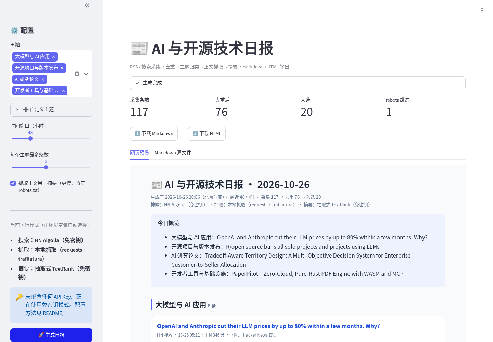
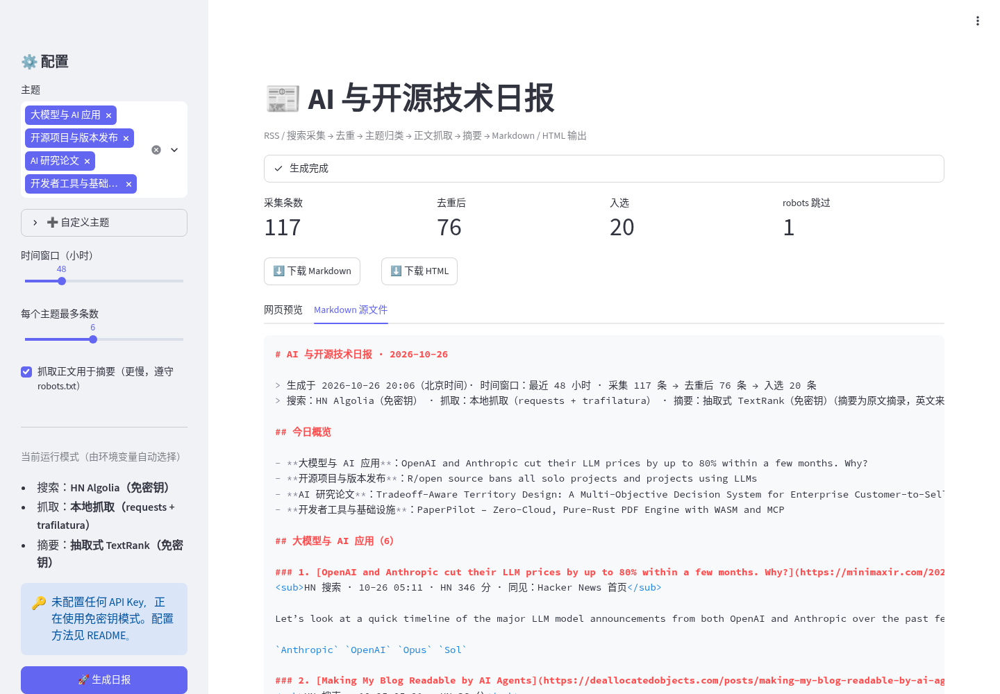
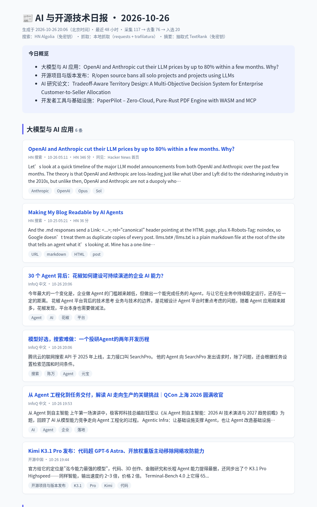
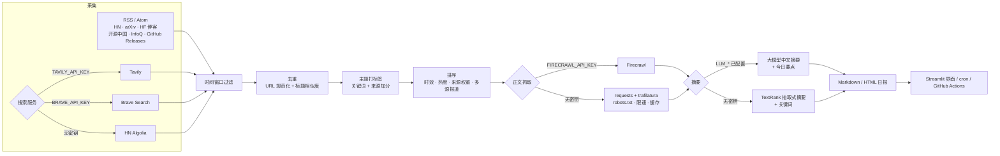

# news-digest · AI 与开源技术资讯日报

一个「网页抓取 + 搜索 + 摘要」的资讯汇总工具：从 RSS/Atom 订阅和搜索服务采集最近的 AI 与开源技术动态，去重、按主题归类、抓取正文并生成摘要，输出**中文日报**（Markdown + 单文件 HTML），并提供 Streamlit 界面。

- **可插拔**：搜索（Tavily / Brave Search）、正文抓取（Firecrawl）、摘要（任意 OpenAI 兼容大模型）都通过环境变量启用；
- **零密钥可运行**：不配置任何 Key 时自动使用 RSS + HN Algolia 公共 API + `requests`/`trafilatura` 本地抓取 + 抽取式 TextRank 摘要，开箱即用；
- **抓取礼仪**：遵守 `robots.txt`（含 `Crawl-delay`）、按域名限速、表明身份的 User-Agent、本地缓存避免重复请求；
- **主题可配置**：在 `config/topics.yaml` 中增删主题、关键词与订阅源，或在界面中临时添加主题。

示例产物：[`docs/sample_digest.md`](docs/sample_digest.md) / [`docs/sample_digest.html`](docs/sample_digest.html)（免密钥模式真实运行生成）。

## 截图

| Streamlit 界面 | Markdown 源文件 | HTML 日报 |
|---|---|---|
|  |  |  |

## 架构



## 快速开始

```bash
python -m venv .venv && source .venv/bin/activate
pip install -r requirements.txt

# 命令行生成日报（默认输出到 output/）
python -m digest run
python -m digest run --hours 24 --topics "大模型与 AI 应用" "AI 研究论文"

# 图形界面（仅监听本机 127.0.0.1:8501）
streamlit run app.py

# 单元测试（离线，远程服务均为 mock）
python -m pytest -q
```

## 服务配置

复制 `.env.example` 为 `.env` 填写需要的项，加载后运行（`set -a && source .env && set +a`）。都不填即为免密钥模式。

| 能力 | 环境变量 | 未配置时的回退 |
|---|---|---|
| 搜索 | `TAVILY_API_KEY`（优先）或 `BRAVE_API_KEY`；`SEARCH_PROVIDER=tavily\|brave\|hn` 可强制指定 | HN Algolia 公共 API（按关键词搜索近期高分讨论） |
| 正文抓取 | `FIRECRAWL_API_KEY`，自托管时加 `FIRECRAWL_API_URL` | `requests` + `trafilatura` 正文抽取 |
| 摘要 | `LLM_BASE_URL` + `LLM_API_KEY` + `LLM_MODEL`（OpenAI 兼容，如 DeepSeek、通义千问、Moonshot、本地 Ollama `http://localhost:11434/v1`） | TextRank 抽取式摘要 + 关键词 |
| 限速 | `DIGEST_MIN_INTERVAL`（秒，默认一秒） | — |

主题与订阅源在 `config/topics.yaml` 中配置：

```yaml
topics:
  - name: 大模型与 AI 应用
    queries: [LLM, AI agent, RAG]          # 发给搜索服务的检索词
    keywords: [llm, 大模型, agent, rag, fine-tun*]   # 用于打标签；英文按词边界匹配，* 表示前缀
  - name: AI 研究论文
    sources: [arXiv]                        # 来自这些来源的条目额外加分
    keywords: [paper, benchmark, 论文]
feeds:
  - {name: InfoQ 中文, url: "https://www.infoq.cn/feed", lang: zh, weight: 1.0, fetch: true}
```

## 定时运行

- **cron**：见 [`scripts/cron.example`](scripts/cron.example)（每天北京时间八点）。
- **GitHub Actions**：[`.github/workflows/digest.yml`](.github/workflows/digest.yml) **默认不运行**——需在仓库变量中设置 `ENABLE_DIGEST=true`，定时触发需取消 `schedule` 的注释；密钥通过 Secrets 注入，产物以 Artifact 形式上传，不会提交回仓库。

## 设计取舍

- **为什么默认免密钥**：作品要能被任何人克隆后直接跑通；付费服务只作为“增强”，接口一致（`SearchProvider` / `Fetcher` / `Summarizer`），按环境变量自动切换，失败时逐级降级（如大模型调用失败自动回退抽取式摘要），保证日报总能生成。
- **去重**：先做 URL 规范化（去掉 `utm_*` 等跟踪参数、`www.`、末尾斜杠，统一 arXiv 的 abs/pdf/版本号），再用字符 n-gram TF-IDF 余弦相似度合并标题相近的报道；被合并的来源记为“同见”，并作为排序加分项（多源报道通常更重要）。
- **主题归类**：用可解释的关键词规则而非聚类模型——资讯量小（每天百条量级）时规则更稳定、可控，也方便用户自己加主题；每条只出现在最相关的主题下，其余主题以标签展示。
- **排序**：时效衰减 × 来源权重 × 热度（HN 分数取对数）× 多源报道加成。
- **抽取式摘要**：句子相似度图上的 TextRank，叠加新闻“导语优先”的位置先验，并过滤命令行、代码、链接类句子；中文关键词用 jieba，英文用简单词频。
- **抓取礼仪**：对每个站点先读取 `robots.txt`（`401/403` 视为禁止，`404` 视为允许，`5xx`/网络错误保守视为禁止），遵守 `Crawl-delay`，同域名请求串行限速，失败重试带退避；例如 `export.arxiv.org` 的 robots.txt 禁止抓取，因此改用官方的 `rss.arxiv.org`。
- **版权**：日报只保存标题、简短摘录/摘要和原文链接，正文仅在本地缓存用于生成摘要，不做转载。

## 已知限制

- 免密钥模式下摘要是原文摘录，**英文来源保留英文**；配置大模型后才会统一生成中文摘要与“今日要点”。
- Tavily / Brave / Firecrawl / 大模型接口按官方文档实现，并有 mock 测试覆盖请求格式，但作者未在真实密钥下长期验证。
- 订阅源地址与格式可能变化；部分站点（如需要 JavaScript 渲染的页面）本地抓取拿不到正文，会回退使用订阅源自带的摘要。
- 个别订阅源的时间戳时区标注不准确，晚于当前时间的条目按当前时间处理。

## 目录结构

```
news-digest/
├── app.py                 # Streamlit 界面
├── config/topics.yaml     # 主题、关键词、订阅源
├── digest/
│   ├── http.py            # 礼貌的 HTTP 客户端：robots.txt、限速、重试、缓存
│   ├── sources.py         # RSS + 搜索（Tavily / Brave / HN Algolia）
│   ├── fetchers.py        # 正文抓取（Firecrawl / trafilatura）
│   ├── dedupe.py          # URL + 标题去重
│   ├── tagging.py         # 主题打标签
│   ├── summarize.py       # 大模型 / TextRank 摘要
│   ├── render.py          # Markdown / HTML 输出
│   └── pipeline.py        # 主流程
├── docs/                  # 示例日报
├── screenshots/
├── scripts/               # 截图脚本、cron 示例
├── tests/
└── .github/workflows/digest.yml
```

## License

[MIT](LICENSE)
